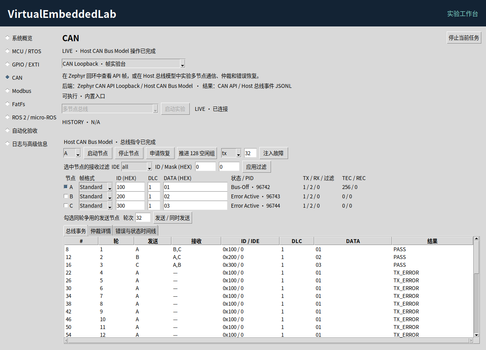

# CAN-H2 · 多节点通信、仲裁与故障恢复

运行 `python3 scripts/vel.py dashboard`，打开 **CAN** 页。

| 模式 | 证据来源 | 操作 |
| --- | --- | --- |
| 交互会话 | Zephyr CAN API Loopback | 原 CAN-H1 单节点回环、标准/扩展帧、IDE 过滤 |
| 多节点总线 | Host CAN Bus Model | A / B / C 的进程间通信、同轮争用、错误限制与恢复 |
| 单项实验 | Stage 8.1 Zephyr native_sim | 原 GPIO、UART 与 CAN 千帧验收 |

选择 **多节点总线** 后启动，页面显示三个节点当前 PID、状态、计数、TEC/REC。逐行设置帧格式和 ID/DLC/DATA，勾选一行可单发，勾选多行并点击 **发送 / 同时发送** 可构成同一仲裁轮。接收过滤按选中节点设置 IDE、ID 和 Mask。左侧节点选择用于停止、重新启动、注入故障和恢复。软件模型可在没有 Zephyr 或 SocketCAN 权限时单独运行。



[仲裁截图](evidence/can_h2/arbitration.png) · [错误状态截图](evidence/can_h2/errors.png)

## 进程与事件证据

Tk 通过监督器向总线服务发命令。服务启动 A、B、C 三个独立 Python 进程，以专用 stdin/stdout 匿名管道进行有界 RPC。发送节点通过管道返回待仲裁帧，接收节点在自身进程中判断过滤并确认收到的 ID、IDE、DLC、DATA、来源及投递编号。每个节点独立更新 TX/RX、过滤、TEC/REC 和恢复状态。单节点停止时保存其状态，重新加入会创建新 PID 并恢复该状态。在 Bus-Off 中停止再启动也保持 Bus-Off。

日志 `can-bus.jsonl` 记录来源和接收目标、帧字段、事件序号、仲裁轮、状态转换、Host 单调时间及结果。GUI 读取此日志，不生成节点 RX 记录。Host 时间表示软件事件顺序。总线、节点与管道均在监督器管理范围内，实验不创建文件系统 Socket。检查了 `/home/bridge/projects` 和 `/home/bridge/protect` 的本地项目目录，未找到可复用的 CANBusLab 模块，因此在当前工程中实现模型。

## 仲裁与错误规则

同轮请求按 Classical CAN 数据帧的逻辑仲裁字段比较。0 为显性，1 为隐性，在第一个不同位处先发送 0 的候选优先。标准与扩展共享同一 11 位基础 ID 时，标准数据帧的 RTR=0 胜过扩展帧的 SRR=1；扩展格式随后还有 IDE=1。失败者进入下一轮，仲裁失败不增加错误计数。仲裁字段相同且整帧一致时合并为一次总线发送；载荷不同时生成冲突并给参与的发送节点加 TEC，故障帧不会投递。模型在冲突后继续处理低优先级候选；注入发送错误后的重发由操作者控制。[Bosch CAN Specification 2.0，Part B 仲裁与 Fault Confinement](https://tekeye.uk/downloads/can2spec.pdf)

| 实验事件 | 模型处理 |
| --- | --- |
| 成功发送 / 接收 | TEC / REC 分别减 1，最低 0。成功接收时若 REC 已超过 127，确定性地置为 127。接收过滤只影响上层投递，正确帧仍可获 ACK |
| `tx` 发送错误 / 载荷冲突 | 发送者 TEC +8 |
| `ack` 缺失 / 无可 ACK 的节点 | 发送者 TEC +8；已为 Error Passive 时，模型采用无显性错误标志的 ACK 例外，TEC 保持 |
| `rx` 接收错误 | 指定节点 REC +1，不接收该帧；其他可接收节点仍可在模型中确认此帧 |
| 任一计数达到 128 | Error Passive |
| TEC 达到 256 | Bus-Off，拒绝发送且退出接收和 ACK |
| 申请恢复并推进总线空闲组 | 先进入 Recovery，期间禁止发送。累计 128 个模型空闲组后重置 TEC/REC，重新加入 Error Active。每组代表 11 个连续隐性位的经典恢复条件 |

恢复组数是显式输入的仿真事件。接收错误为局部故障注入，不重建物理错误标志、位填充和传播。证据支持的是软件规则与 IPC 行为。真实 CANH/CANL、物理 ACK、仲裁位波形、bxCAN 寄存器、真实 Bus-Off 与 HIL 均为 **NOT TESTED**。SocketCAN/vcan 因权限不足为 **BLOCKED**，本模型使用管道。

## 复验

```bash
python3 tests/gui/test_can_bus.py Model IPC
python3 tests/gui/test_can_bus.py Window
python3 tests/gui/test_can_inspector.py Frames Native Window
python3 scripts/accept_stage8_1.py --backend native_sim
python3 tests/gui/test_rtu_inspector.py
python3 scripts/accept_gui_h1.py
python3 scripts/accept_stage8_2.py --mode fault
python3 scripts/accept_stage8_3.py --mode all
```

窗口测试要求真实 WSLg。如需截图，预先创建目录并设置 `VEL_H2_SCREENSHOTS`，截图工具为 ImageMagick `import`。

## 验收结果

| 检查 | 实测 |
| --- | --- |
| 模型单测及 IPC 集成 | 6/6。三个节点各发送 334 帧，合计 1,002 帧，核对 2,004 次正常投递。零意外丢失、重复或错配；另有两次过滤和一次离线排除 |
| 仲裁与重试 | 252 个总轮次，含 108 个初始争用与 36 个再次争用。36 个同仲裁字段、不同载荷的冲突未投递，剩余候选正常仲裁 |
| 错误限制 | 断言 Error Active → Error Passive（TEC=128）→ Bus-Off（TEC=256）→ Recovery → Error Active（TEC/REC=0）。验证 Passive ACK 例外、REC 更新、Bus-Off 和 Recovery 拒发、其他节点继续通信 |
| WSLg | 1/1，切换 CAN 模式、三节点争用、查看胜负依据、注入 32 次发送错误、从 Bus-Off 恢复、节点单独重启、整场停止重开及窗口关闭。验证节点、服务、监督器、管道和会话锁释放 |
| CAN-H1 Frames / Native / Window | 6/6，保留原 Zephyr API 千帧与实际窗口测试 |
| Stage 8.1 | native_sim 4/4，原 CAN 1,000/1,000 |
| RTU-H2、GUI-H1 | 各 7/7，均含实际 WSLg |
| Stage 8.2 Fault、Stage 8.3 Gateway | 分别 3/3、7/7 |
| 历史 133 项 | BLOCKED。历史入口要求 ROS 2 Lyrical，当前为 Jazzy，另缺 Stage 7 的 micro-ROS 锁文件及元数据 |

WSLg 样本第 1 轮 A（0x100）优先于 B（0x200）和 C（0x300），B/C 在下一轮继续。A 进入 Bus-Off 后被拒发，恢复后再次向 B/C 成功广播。[投递样本](evidence/can_h2/ipc-deliveries-sample.jsonl) · [仲裁样本](evidence/can_h2/arbitration-sample.jsonl) · [错误状态样本](evidence/can_h2/recovery-sample.jsonl) · [WSLg 事件](evidence/can_h2/wslg-sample.jsonl) · [机器摘要与完整日志 SHA‑256](evidence/can_h2/summary.json)
