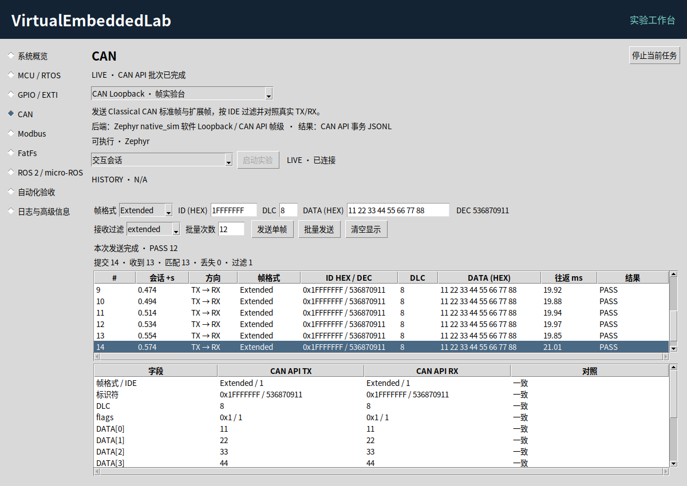

# CAN-H1 · Classical CAN 软件回环实验台

启动 `python3 scripts/vel.py dashboard`，进入 **CAN → 交互会话 → 启动实验**。选 Standard 11-bit 或 Extended 29-bit，填写十六进制 CAN ID、DLC 和以空格分隔的 DATA。DLC 为 0 时 DATA 留空。单帧发送一次，批量按钮连续发送 1–1,000 次。选择事务可查看实际 TX/RX 的 IDE、ID、DLC、flags 和每个数据字节。表中往返时间是 Host 从提交控制请求到读到固件 RX 事件的单调时钟耗时；同时保存 Zephyr 的独立仿真时间。清空显示只清空窗口列表，会话文件与累计计数保留。

接收过滤可用 `all`（分别启用 Standard/Extended 队列）、`standard` 或 `extended`。例如在 `standard` 下发送合法扩展帧，事务显示 **FILTERED**，保留实际 TX。这个结果来自运行中的 Zephyr 过滤器和接收队列；ID 掩码为 0，当前可选项聚焦 IDE。初始的 **单项实验** 入口仍运行原 Stage 8.1 GPIO / UART / CAN 自检。



## 证据来源

交互固件复用 Stage 8.1 的 `can_loopback0`、`CONFIG_CAN_LOOPBACK` 和 native_sim 构建配置，通过一个独立构建选项切换入口。UART1 PTY 只承载控制请求。TX 在固件调用 `can_send()` 前从同一个 `struct can_frame` 记录，RX 来自 `can_add_rx_filter_msgq()` 安装的真实队列。Host 校验实际提交帧与请求一致，再校验 RX 的 ID、IDE、DLC、flags、DATA 与预期队列，并检查重复。单次等待有界，停止或关闭窗口后由现有监督器与会话清理路径回收进程、PTY 和会话锁。

`can-transactions.jsonl` 保存各事务的调试字段，`can-firmware.log` 保存原始固件记录。界面能在日志页查看这两份文件。[运行摘要](evidence/can_h1/summary.json) · [native_sim 样本](evidence/can_h1/native-frame-samples.json) · [WSLg 原始 CAN API 事件](evidence/can_h1/wslg-firmware.log) · [WSLg 事务](evidence/can_h1/wslg-transactions.jsonl)

真实硬件、物理 CAN 总线、位时序、CRC、ACK、位填充、仲裁及电气故障为 **NOT TESTED**。RTR、CAN FD 与用户自定义 ID 掩码本轮未实现。此实验无需 SocketCAN、vcan 或管理员权限。

## 复验命令

```bash
python3 tests/gui/test_can_inspector.py Frames Native
python3 tests/gui/test_can_inspector.py Window
python3 scripts/accept_stage8_1.py --backend native_sim
python3 tests/gui/test_rtu_inspector.py Frames
python3 tests/gui/test_rtu_inspector.py Window
python3 scripts/accept_gui_h1.py
python3 scripts/accept_stage8_2.py --mode fault
python3 scripts/accept_stage8_3.py --mode all
```

在真实 WSLg 会话执行 `Window`。如需保存截图，先创建输出目录，再设置 `VEL_CAN_SCREENSHOTS` 并安装可用的 ImageMagick `import`。

## 实测结果

| 来源 | 帧格式 | ID（HEX / DEC） | DLC | 实际 TX / RX 数据 |
| --- | --- | --- | --- | --- |
| WSLg 单帧 | Standard | 0x123 / 291 | 4 | `11 22 33 44` / `11 22 33 44` |
| WSLg 批量末帧 | Extended | 0x1FFFFFFF / 536870911 | 8 | `11 22 33 44 55 66 77 88` / `11 22 33 44 55 66 77 88` |
| Native 压力 #1 | Standard | 0x0 / 0 | 0 | 空 / 空 |
| Native 压力 #2 | Extended | 0x1FFFF001 / 536866817 | 1 | `01` / `01` |
| Native 压力 #9 | Standard | 0x4 / 4 | 8 | `08 2D 52 77 9C C1 E6 0B` / `08 2D 52 77 9C C1 E6 0B` |

| 检查 | 实测 |
| --- | --- |
| 输入和帧构造 | 4/4；覆盖 ID、DLC、DATA、格式与批量输入边界 |
| native_sim 连续回环 | 1,000/1,000；Standard 和 Extended 各 500，覆盖 DLC 0–8；零丢失、零重复、零错配 |
| IDE 过滤 | 使用同一个数值 ID 0x321，Standard 和 Extended 队列各命中一次，各排除另一格式一次。这两笔按预期排除的记录状态为 FILTERED |
| 固件非法输入 | 标准 ID 越界、扩展 ID 越界、DLC=9 共 3 笔。均在调用 CAN 发送前被拒绝，无 TX 或 RX 记录 |
| WSLg | 1/1；1 笔标准帧，1 笔预期过滤，12 笔扩展帧批量。实测 14 TX、13 RX、13 匹配。验证字段查看、非法输入、停止、再次启动后关闭，以及进程、PTY 和锁释放 |
| Stage 8.1 旧 GPIO/UART/CAN | 4/4，原 CAN 1,000/1,000 exact；SocketCAN 附加能力因 CAP_NET_ADMIN 缺失为 BLOCKED |
| RTU Inspector、GUI-H1 | 分别 7/7、7/7，均运行真实 WSLg |
| Stage 8.2 Fault、Stage 8.3 Gateway | 分别 3/3、7/7 |

第一次并行运行 WSLg 时，已验证单帧、批量和停止，但其完整测试在第二次构建完成前达到测试截止时间。之后单独复测通过。验收记录保留两次运行的退出码与日志位置。
