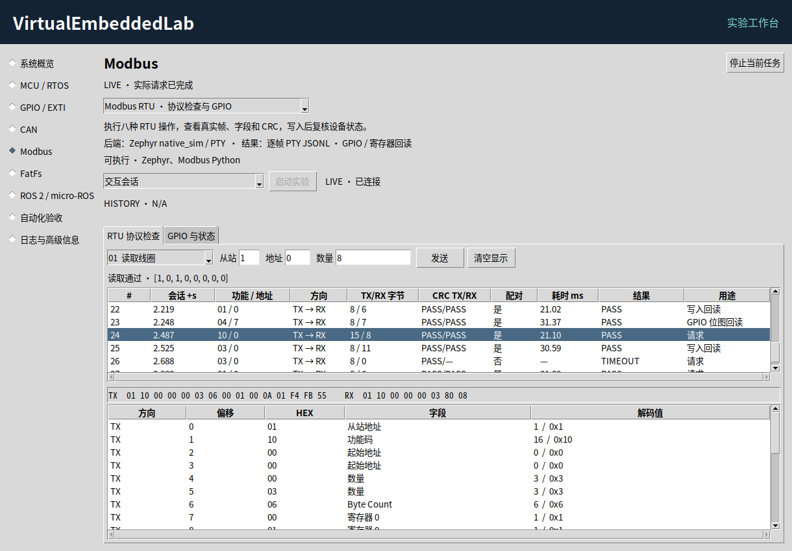

# Stage 8.2-R2 Modbus RTU 协议测试台验收

2026-11-24，WSL2 Ubuntu 24.04 / WSLg，Zephyr native_sim 4.4.2（`dccb09599635bdff17633fa7e9dab014b91dce90`），pymodbus 3.11.4、pyserial 3.5。对应 [Issue #5](https://github.com/Crazypsy92/VirtualEmbeddedLab/issues/5)。

## 使用与检查

运行 `python3 scripts/vel.py dashboard`，选择 **Modbus → Modbus RTU · 协议检查与 GPIO → 交互会话 → 启动实验**。在 **RTU 协议检查** 选择功能码、从站和地址后发送。参数支持十进制和 `0x` 十六进制，多值用逗号分隔。默认从站为 1。写入限于现有寄存器和输出范围，由 FC01、FC03 或 IR7 回读验证。**GPIO 与状态** 保留 DO 操作与 DI 刺激入口。

事务列表同时保留用户请求、写后回读和失败。点击任何一行可查看 TX/RX 完整 HEX、字节偏移、字段值和两端 CRC。时间是相对于本次会话第一笔事务的单调时间，耗时从主站写入到最后一批实际读取字节。清空显示只重置列表，会话日志仍保留。每笔数据随事务结束写入会话目录的 `rtu-transactions.jsonl`，可在日志页查看；`rtu-wire.jsonl` 保留按方向记录的原始帧。



从站继续使用 Zephyr 原有 Modbus Server。主站沿用 R1 的 UART0 接收就绪确认及单调时钟，RTU 超时 150 ms，零重试。采集器包裹 pyserial 的实际读写，单独记录发送前残留字节；UART0 控制字节不进入 RTU 事务。记录独立于 Tk，关闭或 GUI 更新失败不会重写已经落盘的数据。已有部分响应按原样保存，接收错误与 CRC、长度和配对检查分别记录。

## WSLg 实测帧

从实测会话选取以下成功样本。请求和响应的 CRC 均通过，以低字节、高字节的顺序列于帧尾。示例中的寄存器为零基地址。

| 事务 / FC | Master TX | Host 收到的 Slave 回复 | 解析 |
| --- | --- | --- | --- |
| 9 / 01 | `0101000000083dcc` | `010101005188` | DO0–7 均为 0 |
| 10 / 02 | `01020000000479c9` | `01020105618b` | DI0、DI2 为 1，按低位到高位解码 |
| 11 / 03 | `010300000002c40b` | `0103040001000a2bf4` | HR0=1、HR1=10 |
| 12 / 04 | `01040006000291ca` | `01040400050000eb85` | IR6=5、IR7=0 |
| 13 / 05 | `01050000ff008c3a` | `01050000ff008c3a` | DO0 置 1，后续 FC01 和 IR7 一致 |
| 19 / 06 | `010600010014d805` | `010600010014d805` | HR1=20，后续 FC03 回读相同 |
| 21 / 0F | `010f0000000801053e96` | `010f00000008540d` | 写 8 个线圈，Byte Count=1，回读位图 0x05 |
| 24 / 10 | `011000000003060001000a01f4fb55` | `0110000000038008` | 写 HR0–2，Byte Count=6，回读 1、10、500 |

以事务 24 为例，TX 偏移 0 是从站，1 是功能码，2–3 为起始地址，4–5 为数量，6 为 Byte Count，7–12 为三个大端寄存器。13–14 的 `FB 55` 解码为 CRC 0x55FB。响应只回显地址及数量，CRC 为 0x0880。[完整 WSLg 事务 JSONL](evidence/stage8_2_rtu_inspector/wslg-transactions.jsonl) · [独立 native_sim PTY 系统调用记录](evidence/stage8_2_rtu_inspector/native-data-pty.jsonl)

## 验收结果

| 检查 | 实测 |
| --- | --- |
| 解码器单测 | 6/6，通过全部 8 种请求和响应的固定向量，覆盖异常、CRC、数量边界、Byte Count、截断、地址及位序 |
| WSLg 与独立 PTY 字节校验 | 1/1，27 笔请求、26 笔匹配响应，余下 1 笔为发往从站 2 的预期超时。Host TX 与 native_sim PTY RX，native_sim PTY TX 与 Host RX 均逐笔匹配 |
| WSLg GPIO 回读与清理 | DO0 实测 0→1→0，DI 位图实测 0101；选中 FC10 并检查偏移及 HEX；退出后验证 Supervisor、Worker、Slave 与两个 PTY 均已释放 |
| GUI-H1 旧入口 | 7/7，含真实 WSLg 和任务生命周期 |
| Stage 8.2 fault | 3/3，独立用例 42 个尝试，台账含 32 个有效配对、7 个预期异常、1 个 CRC 错误、1 个截断请求和 1 个外站无响应；非法请求后设备状态不变 |
| Stage 8.3 Gateway | 7/7，六组网关测试加独立 RTU/TCP 状态核对 |

正常 WSLg 流量没有部分帧、CRC 错误或错配。故障用例按原测试的实际报文离线解码，保留非法功能码、地址、数量、值和异常回复。[故障帧及解码](evidence/stage8_2_rtu_inspector/fault-frames.json) · [运行摘要](evidence/stage8_2_rtu_inspector/summary.json)

抓包复测中曾观察到关闭时 Slave 收到两次 SIGTERM，退出码为 -15，进程没有残留。将 Slave 放到由会话进程负责终止的独立进程组后，最终运行验证其退出码为 0，Supervisor 仍可收尾清理。

## 复验命令

在工程根目录、普通 WSL 用户下执行。GUI 需要真实 WSLg 会话；独立 PTY 校验使用项目已有的 R1 libc 跟踪器。截图使用 `xdotool` 和 ImageMagick 的 `import`，手动操作无需这两个工具。

```bash
python3 tests/gui/test_rtu_inspector.py Frames
mkdir -p build/rtu-inspector-replay
gcc -O2 -Wall -Wextra -Werror -shared -fPIC host/modbus_master/trace_pty.c \
  -o build/rtu-inspector-replay/trace_pty.so -ldl
VEL_WORK_ROOT="$PWD/build/rtu-inspector-replay/work" \
  VEL_PTY_TRACE="$PWD/build/rtu-inspector-replay/native.jsonl" \
  LD_PRELOAD="$PWD/build/rtu-inspector-replay/trace_pty.so" \
  python3 tests/gui/test_rtu_inspector.py Window
python3 scripts/accept_gui_h1.py
VEL_STAGE8_2_EVIDENCE="$PWD/build/rtu-inspector-replay/fault" \
  python3 scripts/accept_stage8_2.py --mode fault
VEL_STAGE8_3_EVIDENCE="$PWD/build/rtu-inspector-replay/gateway" \
  python3 scripts/accept_stage8_3.py --mode all
```

## 限制与工作区保护

硬件、物理 RS485、真实串口奇偶校验、Ethernet 和电气时序为 **NOT TESTED**。PTY 验证字节流；错误注入使用现有自动化 Fault 路径。Stage 8.3.1 耐久和历史长链未运行。本轮没有增加 TCP 可视化或其他总线功能。

开工时的未提交文件保存在本地 stash 及 `build/stage8_2_r2/protected-20261124-184404/`。GUI-H1 与 RTU-R1 源文件先按 GitHub blob 核对，再以两个普通提交进入 `main`；用户原有未提交改动没有进入发布。GUI-H1 的结果模块只清理了一处原有文件末尾空行，再叠加本轮相关改动。
旧 R1 与 GUI-H1 工作副本的源码已和整合提交比对，没有独有提交或待合并文件。完整目录内容和本地日志已校验归档在 `build/stage8_2_r2/` 的两个 `.tar.gz` 文件中。
