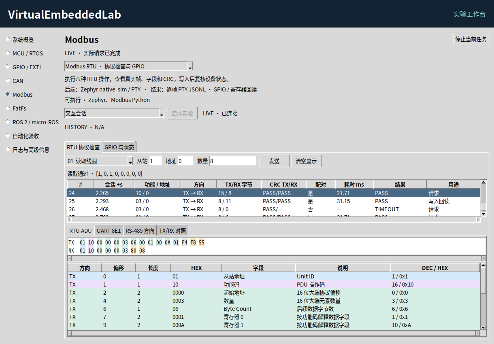

# RTU-H2 · Modbus RTU、UART 与 RS‑485 分层视图

在 WSLg 运行 `python3 scripts/vel.py dashboard`，打开 **Modbus → 交互会话**，发送请求后选中事务。可在同一区域切换 **RTU ADU**、**UART 8E1**、**RS-485 方向**、**TX/RX 对照**。ADU 字段选中后高亮原始 HEX，“查看所选字段的 UART 位”跳到该字段的第一个字节；UART 中选任意字节可反向定位。长帧和事务列表可滚动。

| 视图 | 数据来源 |
| --- | --- |
| RTU ADU / TX/RX 对照 | pyserial 实际收发的原始字节，按既有解码器当前的字段、长度和 CRC 解析 |
| UART 8E1 | 由实际字节和软件串口配置推导；Start=0，D0–D7 低位先发，偶校验，Stop=1，理论约 8.68 μs/bit、95.49 μs/字符 |
| RS-485 方向 | UART0 就绪握手附四字节事务 ID，固件记录接收处理、响应准备、DE/RE 仿真 GPIO 状态变化。Host 写、读及结束时间来自单调时钟 |

方向图横轴是**事件顺序**，使同一个仿真 tick 内的多个转换仍可辨认；表中分开显示 Host 和 Zephyr 的相对时间。Zephyr GPIO 事件表明发送器在软件层何时启用或释放。Host RX 表明响应字节已通过 PTY 到达。UART 最后一个物理停止位、物理静默间隔、A/B 差分电压与真实收发器时序均为 **NOT TESTED / 不可观测**。



[UART 位序](evidence/rtu_h2/uart.png) · [DE/RE 方向图](evidence/rtu_h2/rs485.png) · [TX/RX 对照](evidence/rtu_h2/compare.png)

## 实测样本

FC10 请求 `01 10 00 00 00 03 06 00 01 00 0A 01 F4 FB 55`，回复 `01 10 00 00 00 03 80 08`。偏移 6 是 Byte Count，偏移 7–12 为 1、10、500 三个大端寄存器，TX CRC Lo/Hi 为 `FB 55`（数值 0x55FB）。例如传输字节 `01` 的 UART 示意为 `0 | 10000000 | 1 | 1`，校验位为 1 使 1 的总数为偶数。

本笔及相邻事务使用各自 ID 记录。正常回复中看到 `DE/RE 0/1 → 0/0 → 1/0 → 0/0 → 0/1`；在发送器启用之前，固件已记录 RTU 接收处理与响应准备。向从站 2 发出的预期超时事务，实际仍被从站串口收到并交给 RTU 处理，但未出现发送使能或响应字节。[真实事务和对应事件](evidence/rtu_h2/transactions.json)

## 复跑

```bash
python3 tests/gui/test_rtu_h2.py
python3 tests/gui/test_rtu_inspector.py Frames
python3 tests/gui/test_rtu_inspector.py Window
python3 scripts/accept_gui_h1.py
python3 scripts/accept_stage8_2.py --mode fault
python3 scripts/accept_stage8_2.py --mode protocol
python3 scripts/accept_stage8_3.py --mode all
python3 scripts/accept_stage8_1.py --backend all
python3 scripts/accept_stage8_1.py --backend native_sim
python3 scripts/accept_stage8_1.py --backend renode
```

截图可预先创建目录并设置 `VEL_H2_SCREENSHOTS`；WSLg 测试使用 ImageMagick `import` 按 Tk 窗口 ID 截图。

## 验收结果

| 检查 | 实测 |
| --- | --- |
| RTU 解码 | 6/6，覆盖八种功能码和错误帧 |
| UART 8E1 | 3/3，覆盖五个固定字节、时间计算和时钟来源 |
| WSLg 分层界面 | 1/1，27 个事务 ID，26 个有效响应和 1 个预期超时；切换 FC03、FC06、FC0F、FC10，检查字段高亮、UART 位、方向和 TX/RX 对照；Supervisor、Slave、Worker 和 PTY 均释放 |
| GUI-H1 | 7/7 |
| Stage 8.2 Fault 和 Protocol | 各 3/3；Protocol 压力 1,000 笔，含前置和收尾共 1,026 笔成功 |
| Stage 8.3 Gateway | 7/7，含独立设备状态一致性 |
| Stage 8.1 native_sim、Renode | 分别 4/4 和 3/3；Renode 使用项目中已缓存的固定版本。Renode bxCAN 仍为 UNSUPPORTED |
| 历史 133 项 / QEMU 历史链 | BLOCKED；Stage 7 前置检查要求 ROS 2 Lyrical，本机为 Jazzy，另缺 `micro_ros/dependencies.lock.json`、`micro_ros/arm/colcon.meta`、`micro_ros/stage7_arm.meta`。未进入历史 CTest |
| 真实 UART 电气层、物理 RS‑485、硬件 | NOT TESTED |

历史聚合入口因同一门槛未运行 native_sim 和 Renode，以上结果来自各后端的独立入口。[机器可读结果](evidence/rtu_h2/summary.json)
