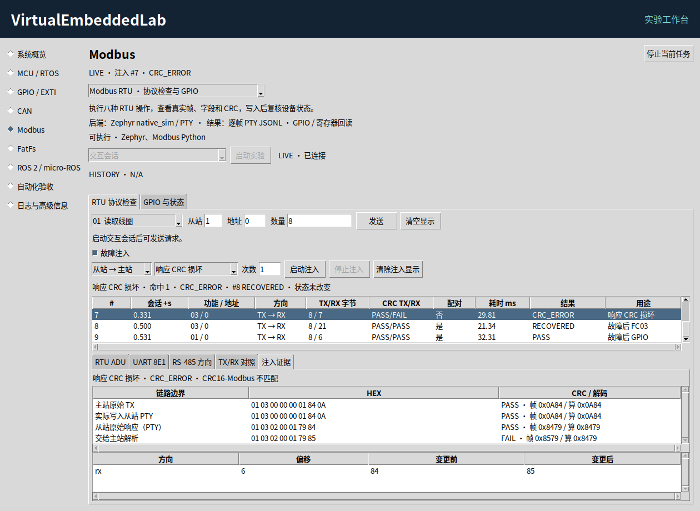

# RTU-H3 · Modbus RTU 故障注入与恢复

运行 `python3 scripts/vel.py dashboard`，选择 **Modbus → 交互会话 → 启动实验**。展开 **故障注入**，选择请求或响应方向、预设及 1–20 次重复，再点击 **启动注入**。每次只安排一笔；只有本笔验证完成后才安排下一笔。**停止注入**取消余下计划，在途事务仍完成恢复。清除注入显示不删除日志。原来的正常操作仍使用 pymodbus。

事务列表和 **注入证据**选项卡可查看四处实际数据、变更偏移和 CRC。选择变更行可定位已存在的 ADU 字节，仍可打开 UART 8E1 或同事务 ID 的仿真 DE/RE。删除的字节只保留原始值和偏移，未返回数据的事务不会渲染回复帧。故障下一笔 FC03 在事务列表显示 `RECOVERED`。

## 架构与证据边界

注入适配层在同一个会话进程内限时独占 native_sim 的真实串口 PTY。主站生成的请求原样记录；适配层按预设变换并从实际串口写入。回复取自 PTY 的实际读操作，适配层对这些字节进行保留、修改、丢弃或隔离延迟，再交给故障单次解析器。真实异常响应来自 Zephyr 服务器。独立 libc PTY 跟踪器在验收中对照每笔的实际从站 RX/TX，因此可同时解释“从站有回复、主站无回复”和“从站无回复”两种情况。

150 ms 接收期限使用 Host 单调时钟。模拟延迟预设在真实回包到达后延迟 220 ms；过期回包只保存在该事务的隔离记录。适配层不把隔离缓冲交给后续请求，额外 PTY 字节导致会话显式失败。恢复使用原 pymodbus 入口、零重试和既有接收就绪握手。下一笔 FC03 读取 8 个寄存器，比对故障前后的保持寄存器，再用 FC01 检查 8 路输出。响应侧预设使用只读 FC03；请求侧拒绝用例使用能检测误执行的拟写入。

数据不会在 GUI 层补造。Host 时间是软件事件时间，Zephyr 方向事件使用仿真时间。真实 RS-485 A/B 电压、物理奇偶校验或位时序、真实 t3.5、物理收发器切换、硬件均为 **NOT TESTED**。

## 复验

```bash
python3 tests/gui/test_rtu_h3.py Rules Native
python3 tests/gui/test_rtu_h3.py Window
python3 tests/gui/test_rtu_inspector.py Frames Window
python3 scripts/accept_gui_h1.py
python3 tests/gui/test_can_inspector.py Frames Native Window
python3 tests/gui/test_can_bus.py Model IPC Window
python3 scripts/accept_stage8_2.py --mode fault
python3 scripts/accept_stage8_3.py --mode all
python3 scripts/accept_stage8_1.py --backend native_sim
```

`Window` 要求真实 WSLg。设置 `VEL_H3_SCREENSHOTS` 到已创建目录可用 ImageMagick `import` 保存截图。`rtu-faults.jsonl` 记录注入源字节、实际四处字节、时间戳和恢复关联；`rtu-transactions.jsonl` 保留 ADU、校验、配对及时间线。可在工作台日志页打开。

## 实测



[非法地址截图](evidence/rtu_h3/tx_address.png) · [迟到隔离截图](evidence/rtu_h3/rx_delay.png)

下表每行取最终原始抓包的一组实际样本。请求方向中原始和实际发出字节可能不同。响应方向的样本同时记录真实从站回复及主站解析输入。HEX 保留原始低字节先发的 CRC 顺序。

| 预设 | 次数 | 原始 TX | 实际写入从站 | 从站实际回复 | 交给主站 | 结果 |
| --- | ---: | --- | --- | --- | --- | --- |
| 请求 CRC | 10 | `010600030001b80a` | `010600030001b80b` | — | — | TIMEOUT |
| 请求截断 | 5 | `010600030001b80a` | `010600` | — | — | TIMEOUT |
| 请求丢弃 | 5 | `010600030001b80a` | — | — | — | TIMEOUT |
| 错误从站地址 | 5 | `010600030001b80a` | `020600030001b839` | — | — | TIMEOUT |
| 未知功能码 | 5 | `010600030001b80a` | `0141000300010c05` | `01c101b050` | `01c101b050` | EXCEPTION 0x01 |
| 非法数据地址 | 5 | `010600030001b80a` | `010600080001c9c8` | `018602c3a1` | `018602c3a1` | EXCEPTION 0x02 |
| 非法数据值 | 5 | `010600000002080b` | `010600000003c9cb` | `0186030261` | `0186030261` | EXCEPTION 0x03 |
| 响应 CRC | 10 | `010300000001840a` | `010300000001840a` | `01030200017984` | `01030200017985` | CRC_ERROR |
| 响应丢弃 | 5 | `010300000001840a` | `010300000001840a` | `01030200017984` | — | TIMEOUT |
| 响应延迟 | 5 | `010300000001840a` | `010300000001840a` | `01030200017984` | — | LATE_RESPONSE |

60/60 条恢复 FC03 紧接失败事务成功返回，且故障前后保持寄存器与 DO 状态均相同。原始从站回复与本次独立 PTY 跟踪器逐笔匹配。15 个异常响应都验证了功能码最高位、异常码及 CRC。请求和响应 CRC 各 10 次真实注入，均无错误 PASS。迟到事务之后的 FC03 实际字节和 CRC 均通过，没有残留并入恢复帧。

| 检查 | 实测 |
| --- | --- |
| RTU-H3 规则与 native_sim | 4/4；10 类 60 笔，另核对从站意外退出、Supervisor 超时、进程与 PTY/锁清理 |
| RTU-H3 WSLg | 1/1；窗口操作响应 CRC、非法地址、迟到，并启动五次请求丢弃计划后停止，实测只执行在途一笔。验证差异定位、恢复及关窗清理 |
| RTU-H2、GUI-H1 | 各 7/7 |
| CAN-H1、CAN-H2 | 分别 6/6、7/7 |
| Stage 8.2 Fault、Stage 8.3 Gateway | 分别 3/3、7/7 |
| Stage 8.1 可运行后端 | native_sim 4/4，旧 CAN 回环 1,000/1,000。使用既有缓存复跑 Renode 3/3，bxCAN 仍为 UNSUPPORTED |
| 历史 133 项 | BLOCKED。当前只有 ROS 2 Jazzy，Stage 7 需 Lyrical，另缺 micro-ROS 锁和元数据 |
| 物理 RS-485 / 真实串口位时序 | NOT TESTED |

[实测注入与恢复样本](evidence/rtu_h3/sample-faults.jsonl) · [独立 PTY 字节记录](evidence/rtu_h3/native-pty-samples.jsonl) · [WSLg 会话记录](evidence/rtu_h3/wslg-faults.jsonl) · [各预设结果和完整原始日志 SHA‑256](evidence/rtu_h3/summary.json)
