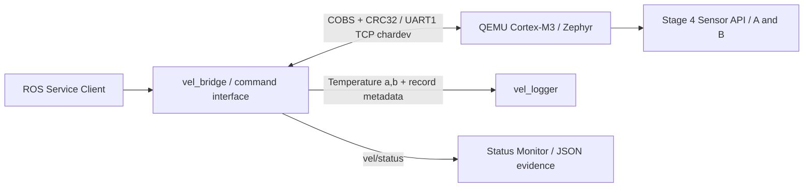

# Stage 5 架构与运行契约

ROS 2 Lyrical 在 WSL Host；Cortex-M3 Zephyr 4.4.2 在独立 QEMU 进程。系统 Python 运行 Bridge、Logger 和 Service Client，colcon 构建位于 `build/workspaces/ros2_stage5_ws`。Zephyr 的现有独立 venv 保持原位。所有构建/测试均以当前 WSL 用户身份运行。

业务 UART1 `0x40005000`，调试 UART0 `0x40004000`。QEMU 官方 `hw/arm/mps2.c` 的五实例循环将 serial_hd(0/1) 映射 UART0/1；Zephyr 的实际生成 devicetree 和 config 保存在外部 memory 日志目录。新 overlay 仅启用 UART1，固件继续调用已有多实例传感器驱动的 `sensor_sample_fetch` / `sensor_channel_get`，不访问驱动私有状态。

## ROS 接口

| 接口 | 类型 | 语义 |
|---|---|---|
| /vel/sensor/a, /vel/sensor/b | sensor_msgs/msg/Temperature | 摄氏度=milli-C/1000；frame_id=vel_sensor_0/1；Host ROS 接收时间 |
| /vel/records | std_msgs/msg/String (JSON) | ID、连续序号、MCU uptime(ms)、原始 milli-C、对应 Temperature 时间戳 |
| /vel/status | std_msgs/msg/String (JSON) | 连接状态、有效/丢弃/重复/超时/协议错误计数 |
| /vel/start, /vel/stop, /vel/get_status | std_srvs/srv/Trigger | 必须匹配 MCU ACK 才返回 success=true |
| /vel/set_rate | rcl_interfaces/srv/SetParameters | 一个 integer 参数 period_ms；10–200ms；MCU NACK 时 successful=false |

标准消息和服务已经覆盖需求，因此没有 vel_interfaces 包。String 元数据保留 MCU 时间与序号；Logger 按 (ID,Header stamp) 同时匹配实际 Temperature 与元数据，不能仅订阅元数据就宣称收到温度话题。

传感器、元数据及状态 QoS：RELIABLE / KEEP_LAST / depth512。Logger 的 40ms 回调延迟使消费落后于产生速率；测试检查实际延迟超过100ms并最终完整收到256条。容量只针对本阶段有限记录会话，不承诺无限期无损。Zephyr tick 为10ms，采样周期10–200ms被tick量化；SET_RATE 的真实效果通过记录的 MCU uptime 差值验证。

## 状态和失败

CONNECTING → READY → STREAMING；成功 ACK 中的 running 决定 READY/STREAMING。序号缺口、重复、CRC、长度、解析超时、MCU ERROR、ACK 超时产生粘性的 ERROR；EOF/OSError 产生 DISCONNECTED。NACK 通过服务失败明确返回。错误后不自动重试命令，也不静默重置传感器序号；通过重启 QEMU 和 Bridge 建立新会话恢复。相同请求缓存重发不重复执行，详见协议文档。

四层计数独立：MCU sampled、MCU sent 在 GET_STATUS ACK 中；Bridge valid 是实际解析与模型校验数；Logger received 是跨 DDS 两类消息匹配后的计数。正常验收每层256，A/B各128。固件完成后 stopped，Host 通过 GET_STATUS 确认。

## 进程和日志

端口只绑定127.0.0.1，自动分配临时端口；每次使用随机 ROS_DOMAIN_ID(100–199) 和独立临时目录，发现范围 LOCALHOST。随机域不是跨所有用户进程的数学唯一性保证；需要并发多套实验时应显式分配互异域。

所有自动脚本限时，并仅结束自己建立的进程组；正常持续运行的 QEMU、Bridge、Logger 在测试断言后由管理器终止并 wait 回收。故障退出被独立测试；不会通过按名称 kill 清理用户其他实例。QEMU 固件另有60秒生命周期限制。原始 ROS日志、采集记录、GDB记录、CTest XML、构建日志在外部工作区 runs/；仓库仅保留摘要及 SHA256 索引。

串行所有权归本轮脚本，socket连接断开后的恢复采用新会话。没有实现真实硬件串口、自动重连续传、micro-ROS或安全认证。
