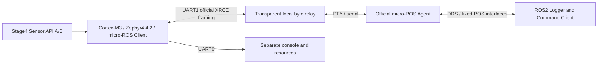

# Stage 6 架构

系统：QEMU MPS2-AN385 Cortex-M3 → Zephyr4.4.2 → 官方rcl/rclc/rmw_microxrcedds/XRCE Client3.0.2 → UART1 → 本地透明字节中继 → PTY → 官方micro-ROS Agent7.0.0 / XRCE Agent3.0.2 → Fast DDS → 普通ROS2 Lyrical节点。

UART0仅输出调试/资源文本；UART1仅交换官方XRCE串行framing。中继仅读写原始字节，既不解释消息，也不添加Stage5 COBS/CRC。Agent端点是真实PTY/serial，TCP只是QEMU字符设备与中继的本地连接。中继捕获原始双向字节到外部日志目录；TCP_NODELAY开启以减少小包延迟。

## 关卡隔离

6.1为真实Linux C Client，经Agent与普通Fast DDS ROS节点通信，并验证Agent退出后Client析构，不代表ARM。6.2最小固件先发布Int32 `/vel/micro_ros/test`，订阅 `/vel/micro_ros/command`，GDB确认官方函数实际在ARM执行。6.2完成后才构建6.3采集目标。

新固件源位于 `zephyr/apps/micro_ros_firmware`，CMake选项VEL_ACQUISITION控制最小或采集入口，共用UART transport。两个构建目录独立：Stage6工作区firmware_build、acquisition_build。Stage5固件和旧Sensor Driver均不改动。采集仍使用原Stage4 Sensor API读取A/B，不复制传感器算法。

## 固定消息版本1.0.0

`micro_ros/vel_micro_interfaces/msg` 同一源定义生成Host及ARM类型支持，字段无动态字符串/无界数组。

| Topic | 消息 | 字段 |
|---|---|---|
| /vel/micro_ros/sensor/a,b | Record | uint8 sensor_id, uint32 sequence, int32 temperature_milli_c, uint32 uptime_ms |
| /vel/micro_ros/command | Command | uint32 request_id, uint8 opcode, uint32 period_ms |
| /vel/micro_ros/ack | Ack | 请求ID/命令/结果/运行状态/周期/采样数/发布数/错误数 |

ROS IDL/CDR负责字节序和对齐，不直接发送C结构体内存。Record的CDR有效字段占16字节（含对齐）；Host/Agent日志分别反序列化/核对全部256条。温度明确为毫摄氏度整数，不冒充标准Temperature摄氏度字段。

## 控制与确认

opcode1 START，2 STOP，3 SET_RATE，4 GET_STATUS，5 FINISH（测试完成后析构资源）。周期10–200ms，非法值ACK.result=2。请求ID非零、32位序号差分前进；旧请求或同ID不同内容result=3，未知命令result=4。只缓存最近一次请求：同ID、opcode及参数重复时重发原ACK，不再次执行。没有无条件重试。

Host发送命令后仅在相同request_id和opcode的ACK到达且result符合预期后继续；Topic publish成功不等于执行成功。STOP后读两次状态证实计数稳定。SET_RATE后逐传感器uptime间隔发生变化；该周期是采样循环间的延迟，实际间隔还包括可靠发送确认、Executor和tick开销，不能当作硬实时精确定时器。

Publisher/Subscriber均RELIABLE；MCU采用rclc默认QoS（KEEP_LAST depth10），Host KEEP_LAST depth512，XRCE MTU512，双向可靠流历史各4、RMW订阅历史8，静态实体池有界。固件实际3个publisher（两数据、一个ACK）、1个subscriber、1个executor handle；配置池上限见memory.json。发布计数只在rcl_publish成功后递增，与Host实际记录数独立。Agent写入DDS的16字节Record日志逐条核对，保留三层独立证据。

## 状态、故障与生命周期

初始化ping有界；没有Agent输出DISCONNECTED NO_AGENT。运行中定期ping并检查发布/执行器返回值；Agent退出或UART断开则停止采样并输出DISCONNECTED。Host命令超时进入ERROR，不将未恢复链路标READY。MCU重启故障由终止本轮QEMU模拟；恢复另起QEMU、Agent和Host新会话，初始stopped且计数0，重新完成256条，不声称断点续传。

80ms消费者回调主动制造DDS积压；测试验证每路无丢失、文件一致，并根据Host接收间隔与MCU uptime变化测量滞后增长。跨两个Topic的全局交错顺序没有DDS保证，比较按(sensor_id,sequence)进行；每个传感器仍必须严格连续。

自动脚本随机选择ROS_DOMAIN_ID和本地端口，Agent通过XRCE_DOMAIN_ID_OVERRIDE把固定255占位域映射到本轮域。该官方版本源码实际支持覆盖；普通节点使用相同域。仅绑定127.0.0.1，不使用真实USB或板卡。每轮临时目录及所有子进程有界，只清理本轮进程组。

## 依赖和构建位置

源码仓库保持原位置；全部第三方源、Host/ARM库、Newlib、Agent、colcon install/log/runs位于 `build/workspaces/micro_ros_stage6_ws`。系统Python用于ROS和colcon；Zephyr west显式用原venv。Newlib私有安装只影响Stage6目标，系统Python、ROS安装、原Zephyr工作区不改变。版本锁验证源文件未被改动。

Host6.1的Agent UDP CLI在3.0.2上没有bind-address参数。为遵守本地端点约束，测试通过独立编译的 `agent_loopback_bind.c` 在**该Agent进程**内将所选XRCE UDP端口的INADDR_ANY绑定改为127.0.0.1，并实际检查 `/proc/net/udp`。该临时LD_PRELOAD库不处理包或消息，不改官方Agent/Client源码，不安装到系统，也不改变其他进程。MCU关卡使用PTY，不依赖此UDP适配器。DDS按ROS_AUTOMATIC_DISCOVERY_RANGE=LOCALHOST隔离，运行时日志记录域ID。
